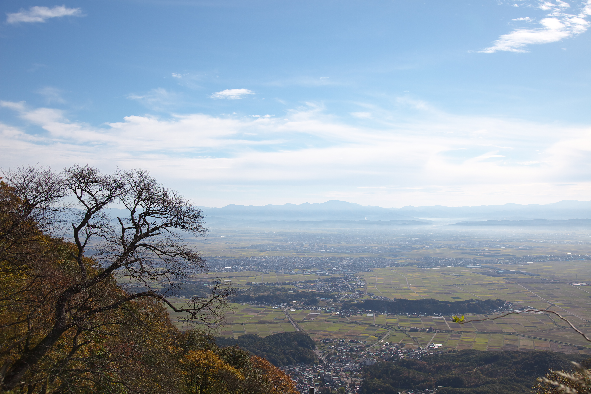
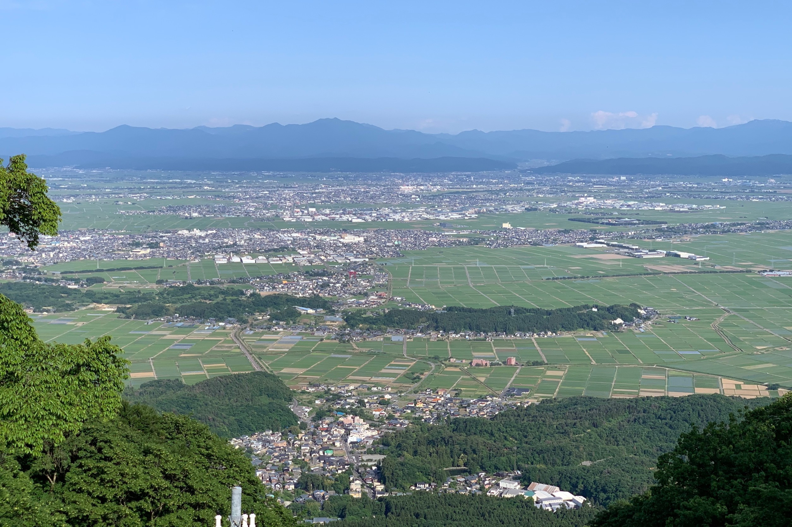
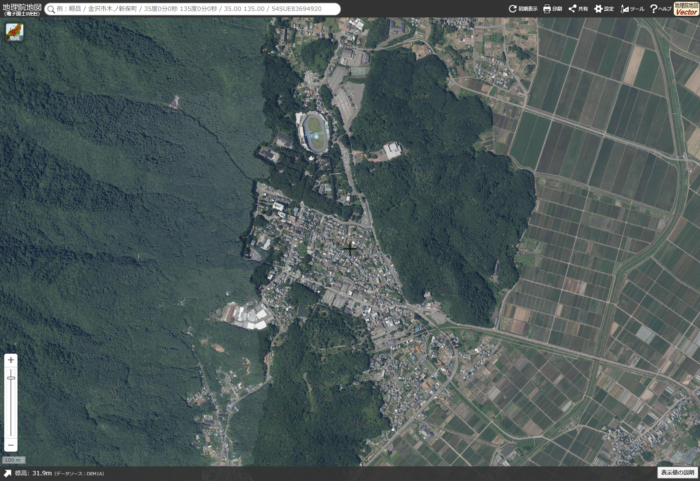
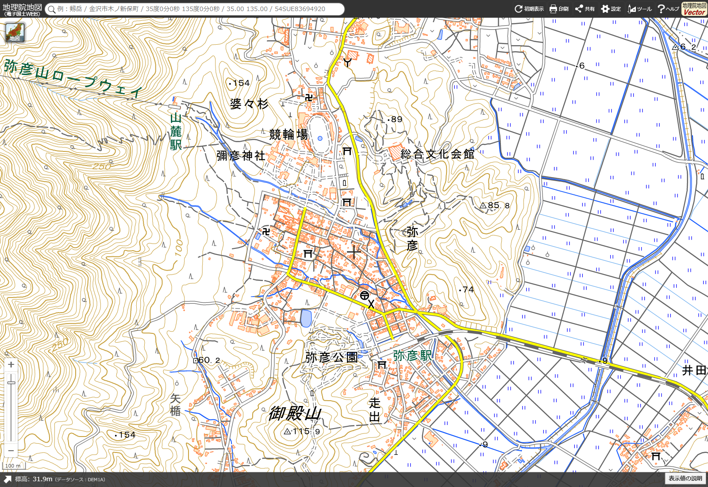

# 弥彦小镇：俯瞰、航空影像与鸟瞰地图

这一组优先解决整体构图：神社、温泉街、树林、山体和平野之间的关系。与上一组街边细节照片分开保存，未修改任何动画。

## 推荐先看什么

1. **想要好看的秋季远景：看 01。** 前景树枝和秋色、山脚小镇、格状田野、远山形成多层景深。
2. **想看清小镇与田野的关系：看 02。** 夏季绿色更清楚，近处小镇与远处城市不要混为一谈。
3. **想把动画里的街区画对：对照 03 航空影像与 04 地图。** 两图同一范围、北向上，可直接对照神社、车站、公园与林地。
4. **想看插画式鸟瞰小镇：打开下面的官方「まちあるきマップ」。** 官方明确介绍它以鸟瞰图方式描绘弥彦温泉街；这是本次最贴合小镇插画方向的地图来源。

## 01｜秋季：树枝框景、小镇、平野与远山

- 作者：**Ignis**；拍摄于 **2012-11-05**。
- [Commons 原图与作者信息](https://commons.wikimedia.org/wiki/File:Echigo_plain_from_Mount_Yahiko_Niigata_JPN_001.jpg)
- 授权：[CC BY-SA 3.0](https://creativecommons.org/licenses/by-sa/3.0/)。原始 JPEG，未裁切或调色。
- 推荐参考：前景枝叶作为画框，山脚房屋只是中近景一层，远处田野与蓝灰色山脉拉开纵深。
- 这是从山上拍摄的斜俯视实景，不是无人机航拍；不能从这张远景准确还原神社建筑细节。

## 02｜夏季：山脚聚落与绿色田野

- 作者：**Drph17**；拍摄于 **2020-06**。
- [Commons 原图与作者信息](https://commons.wikimedia.org/wiki/File:View_from_Mount_Yahiko_001_June2020.jpg)
- 授权：[CC BY 4.0](https://creativecommons.org/licenses/by/4.0/)。原始 JPEG，未裁切或调色。
- 来源说明：弥彦山九合目、山顶缆车站附近望向越后平野；近处为弥彦村，远处为燕市街区。
- 推荐参考：小镇嵌在林地边缘，外侧衔接规则田块；不是密集高楼城市，也不是全由传统木屋组成的古镇。

## 03｜正上方航空影像：看真实街区形状

出典：**国土地理院ウェブサイト（地理院地図・全国最新写真／seamlessphoto）**。

- [打开同一范围的交互航空影像](https://maps.gsi.go.jp/#16/37.703000/138.830000/&base=ort&ls=ort&disp=1)
- 2026-11-05 截取网页视图，1600×1100；北向上，中心 37.703000°N / 138.830000°E，zoom 16。保留网站界面和比例尺，未改动影像内容。
- **截图日期不是航摄日期。** 本次未核定该区域底图的拍摄年份；也不把「全国最新写真」理解为实时照片。
- 看点：西侧山林、神社周围林地、中间不规则街区与东侧规整田块。与下一张地图对照，不凭屋顶猜具体建筑名称。

## 04｜同范围地形与道路地图

出典：**国土地理院ウェブサイト（地理院地図・標準地図）**。

- [打开同一范围的交互地图](https://maps.gsi.go.jp/#16/37.703000/138.830000/&base=std&ls=std&disp=1)
- 2026-11-05 截取，1600×1100；范围、方向与 03 相同，保留网页界面和比例尺。
- 地图可直接找到彌彦神社、弥彦公园、弥彦站、缆车山麓站和竞轮场，适合核对空间关系，不是旅游氛围插画。

### GSI 使用说明

- [国土地理院内容利用条款（PDL 1.0，含例外）](https://www.gsi.go.jp/kikakuchousei/kikakuchousei40182.html)
- [地图／航空照片利用手续与用途分类](https://www.gsi.go.jp/LAW/2930-index.html)
- 本组以构图参考文档插图形式记录局部视图，不是测量成果或独立地图产品。保留上述来源；后续编辑、加标记或重绘时注明加工，不得冒称国土地理院制作。
- 后续如果改为地图产品、数据分发或测量用途，应按该用途另行核对手续；不要把本说明理解为所有用途均无需申请。照片图层与标准地图的适用分类也不同。

## 05｜特别推荐：官方插画鸟瞰图（仅保存链接）

### 弥彦まちあるきマップ／弥彦街歩きマップ

- [打开官方 A3 地图 PDF](https://www.e-yahiko.com/hp2/assets/pdf/%E5%BC%A5%E5%BD%A6%E8%A1%97%E6%AD%A9%E3%81%8D%E3%83%9E%E3%83%83%E3%83%97.pdf)
- [官方地图与手册目录](https://www.e-yahiko.com/document/)
- 官方介绍：以鸟瞰图形式描绘弥彦温泉街，背面含餐饮、土产店和景点简述。适合参考如何把真实街区简化成可读的旅行插画；不应逐项复制其美术表达。

### 弥彦温泉 JOY マップ

- [打开官方 JOY 地图 PDF](https://www.e-yahiko.com/hp2/assets/pdf/joymap.pdf)
- 适合补充景点与店铺位置；营业信息仍需另核实。

以上 PDF 未确认开放转载许可，**未把文件或截图上传到本库**，仅记录官方链接。官方旅游图库另有仅限旅游宣传、禁止加工和商业使用等限制，不能当成通用开放图片库：[图库及条款](https://www.e-yahiko.com/download/)。

## 检查与边界

- 已逐张查看两张照片及两张地图截图；两次地图截图均确认 35 个加载中的地图瓦片全部加载成功。
- 两张照片保留原始字节；来源、授权及校验值见 [`sources.json`](sources.json)。截图对应来源和范围也记录于该文件。
- 照片并非当下实况，航空影像拍摄年份未核定；官方地图的商户现状未核验。
- 与此前街边照片互补：[街边细节参考](../yahiko-town-photos/README.md)。
