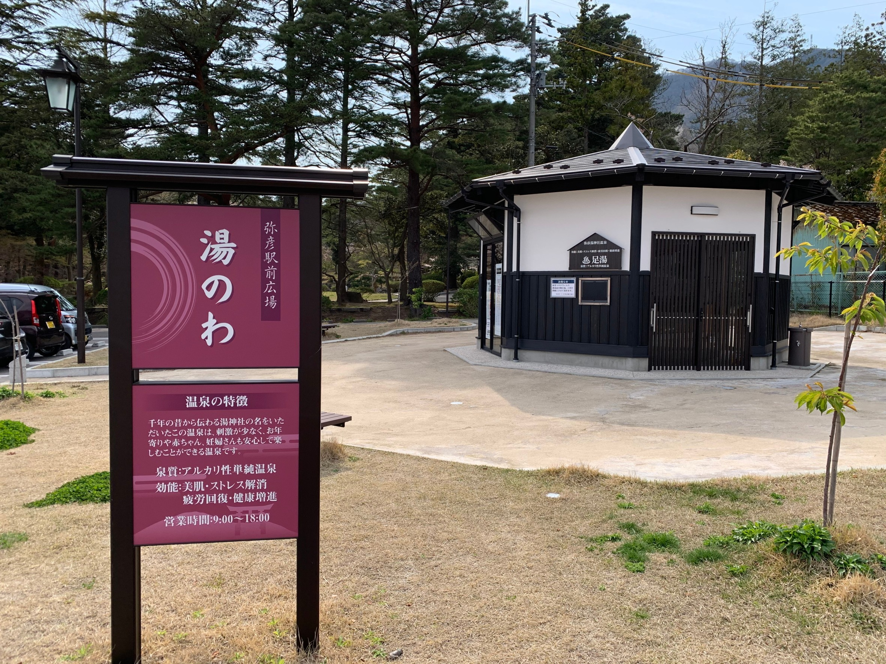

# 弥彦神社外的小镇：实景照片参考

用于门前町、外苑坂通及站前街区的建筑与道路参考。按用户要求收集入库，未嵌入动画，也未修改任何动画版本。四张均为 Wikimedia Commons 上的实拍原图，未裁切、调色或缩放。

**照片拍摄于 2015 / 2020 年，不代表现在的店铺、招牌或营业情况；也不是秋季夜景参考。** 神社门前与站前是不同地点，不应把下面的设施当作同一个街角。

## 1. 神社门前道路：沿商店街望向鸟居（最推荐）

- 文件：`01-shrine-approach.jpg`
- 原作标题：新潟県道29号線2.JPG
- 作者：**Gameshopaki**；拍摄日期：2015-09-27。
- [来源与原作者页面](https://commons.wikimedia.org/wiki/File:%E6%96%B0%E6%BD%9F%E7%9C%8C%E9%81%9329%E5%8F%B7%E7%B7%9A2.JPG)
- 授权：[CC BY-SA 4.0](https://creativecommons.org/licenses/by-sa/4.0/)。修改：无。
- 看点：两侧店铺高度并不统一；木构、抹灰和瓷砖外墙混合；深屋檐、暖帘、灯笼式路灯、电线杆、道路边线，街道尽头可见神社鸟居。

## 2. 外苑坂通：店铺、道路与背后的山

- 文件：`02-gaienzaka-street.jpg`
- 原作标题：Yahiko Gaienzaka-dori Street April2020.jpg
- 作者：**Drph17**；拍摄日期：2020-04。
- [来源与原作者页面](https://commons.wikimedia.org/wiki/File:Yahiko_Gaienzaka-dori_Street_April2020.jpg)
- 授权：[CC BY-SA 4.0](https://creativecommons.org/licenses/by-sa/4.0/)。修改：无。
- 看点：分水堂菓子铺、旅游咨询处等低层街面，山体紧贴小镇背景；可参考道路宽度、店招和建筑比例。

## 3. おもてなし広場：款待广场与商业建筑

- 文件：`03-omotenashi-hiroba.jpg`
- 原作标题：Yahiko Omotenashi Hiroba April2020.jpg
- 作者：**Drph17**；拍摄日期：2020-04。
- [来源与原作者页面](https://commons.wikimedia.org/wiki/File:Yahiko_Omotenashi_Hiroba_April2020.jpg)
- 授权：[CC BY-SA 4.0](https://creativecommons.org/licenses/by-sa/4.0/)。修改：无。
- 看点：外苑坂通沿线的商业设施，深色坡屋顶、木柱廊架、开放广场、停车空间与山体背景。不是神社内部建筑。

## 4. 弥彦站前足汤「湯のわ」：小型温泉设施

- 文件：`04-station-footbath.jpg`
- 原作标题：Yahiko Station Yunowa April2020.jpg
- 作者：**Drph17**；拍摄日期：2020-04。
- [来源与原作者页面](https://commons.wikimedia.org/wiki/File:Yahiko_Station_Yunowa_April2020.jpg)
- 授权：[CC BY-SA 4.0](https://creativecommons.org/licenses/by-sa/4.0/)。修改：无。
- 看点：白墙、深色格栅、低矮屋顶和独立招牌。位于站前，不是神社门口；照片只展示设施外观，不能据此推断内部浴池。

## 授权与使用边界

- 四张照片各自按 **Creative Commons Attribution-ShareAlike 4.0 International（CC BY-SA 4.0）** 使用，版权属于上述原作者，不属于本仓库作者。
- 转载时保留作者署名、来源和许可链接；修改照片时标明修改，并遵守相同方式共享要求。照片许可不等于对可见商标、人物肖像等其他权利的额外授权。
- 当前用途是制作参考；未把图片打包进动画或导出视频。若之后直接使用或改编照片发布，应另核对署名安排和许可义务。
- 机器可读的来源、拍摄日期、原图地址、文件大小和 SHA-256 校验值见 [`sources.json`](sources.json)。
