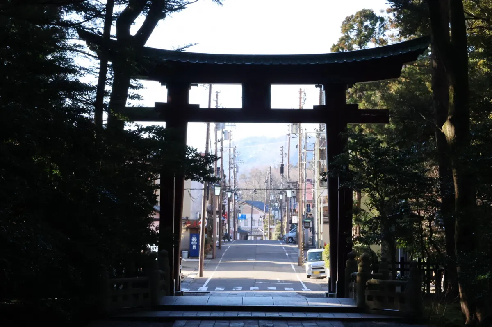
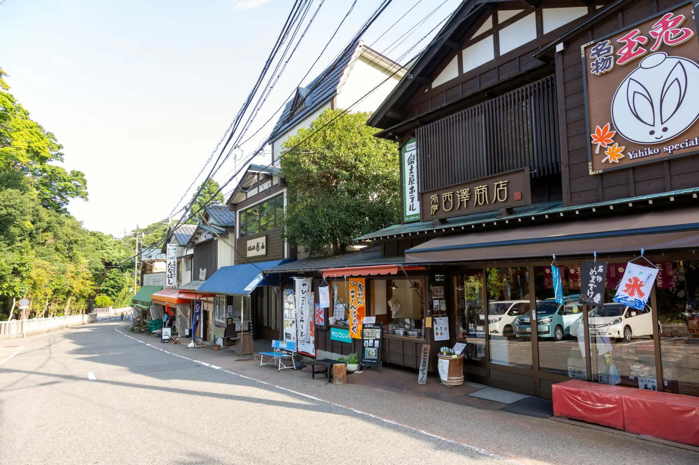
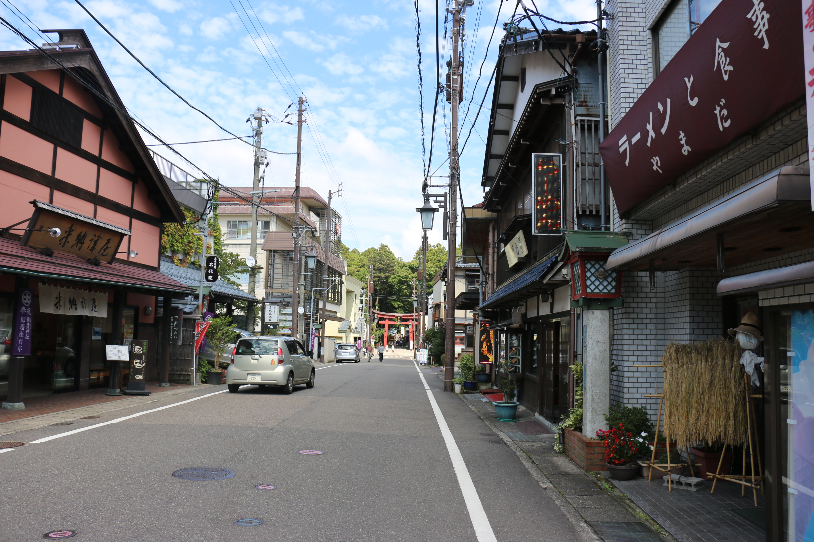
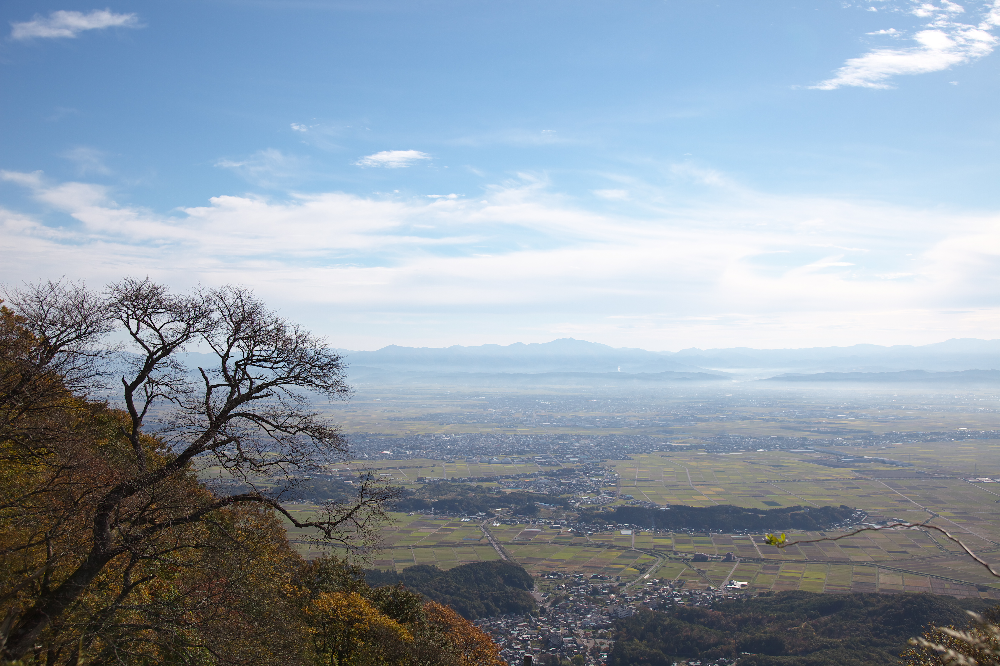
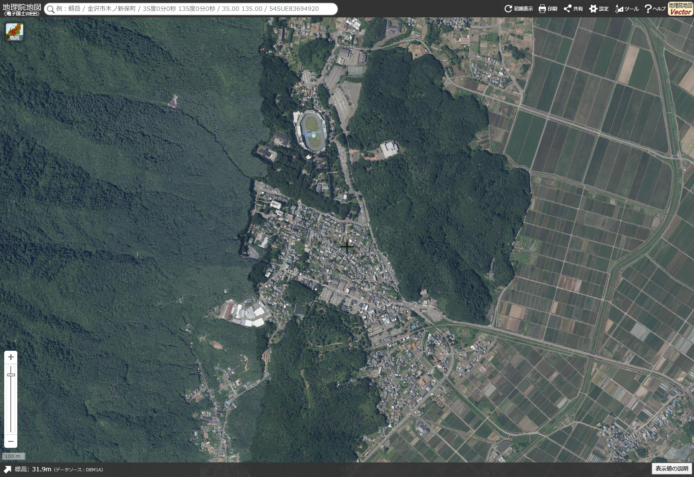

# 弥彦神社与门前小镇：5 张布景参考

## 1｜从神社向外看
站在一之鸟居内侧望向门前街道，以树荫、鸟居和石阶框出明亮的小镇，是本组的主要视角参考。

[来源：新潟县观光协会／井高あゆみ](https://niigata-kankou.or.jp/blog/detail_1414.html)

## 2｜神社旁的店铺
神社旁土产店街的侧向实景，参考木格栅、屋檐、遮阳棚和店面层次，不是第 1 张正前方街道的同方向延续。

[来源：GOOD LUCK TRIP](https://www.gltjp.com/ja/article/item/20897/)

## 3｜从街道望向神社
沿门前街道望向远处鸟居，参考道路宽度、两侧建筑高低及街道与神社入口的关系。

[来源：Gameshopaki／Wikimedia Commons](https://commons.wikimedia.org/wiki/File:%E6%96%B0%E6%BD%9F%E7%9C%8C%E9%81%9329%E5%8F%B7%E7%B7%9A2.JPG) · [CC BY-SA 4.0](https://creativecommons.org/licenses/by-sa/4.0/) · 2015-09-27 · 未修改。

## 4｜秋季小镇俯瞰
从弥彦山俯瞰山脚小镇与越后平野，参考前景秋色、聚落、田野和远山的景深层次。

[来源：Ignis／Wikimedia Commons](https://commons.wikimedia.org/wiki/File:Echigo_plain_from_Mount_Yahiko_Niigata_JPN_001.jpg) · [CC BY-SA 3.0](https://creativecommons.org/licenses/by-sa/3.0/) · 2012-11-05 · 未修改。

## 5｜正上方航空影像
北向上的弥彦神社与小镇航空影像，用于核对神社、街区、树林与田野的真实布局。

出典：[国土地理院・地理院地図（seamlessphoto）](https://maps.gsi.go.jp/#16/37.703000/138.830000/&base=ort&ls=ort&disp=1) · [利用条款](https://www.gsi.go.jp/kikakuchousei/kikakuchousei40182.html) · 2026-11-05 网页截图，中心 37.703°N / 138.830°E，zoom 16，1600×1100，未修改影像；航摄年份未核定。

---
仅作为动画布景参考，未嵌入动画；前两张保留原来源，不能据此视为开放授权素材。原始地址与文件校验值见 [sources.json](sources.json)。
