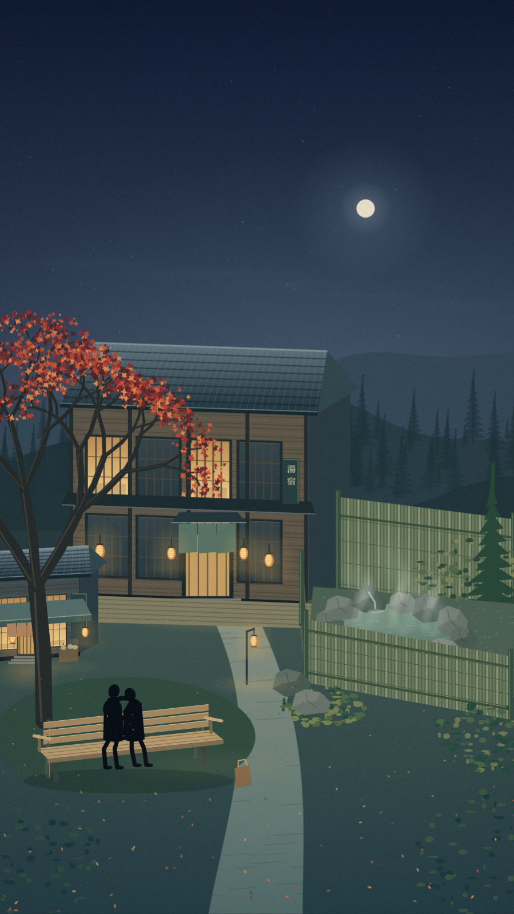

# 红叶小镇 · 老旅馆与汤后休息

本张保留用户确认的岩石温泉与竹篱布局，加入五个元素：红叶、两位相依的黑色剪影、老旅馆、温泉、小商铺。人物借鉴 v24 `bridgeVisitors` 的近黑色（`#080e15`）、双头轮廓、相依姿态和隐藏手部，改成长椅上的坐姿；小茶铺放在左侧画面边缘，不抢旅馆主体。

打开 `index.html` 查看，`?export` 用于导出 900×1600 原图。源码使用 Canvas 绘制，无外部依赖；温泉形制参考 [岩室温泉ゆもとや官方照片](https://yumotoya.co.jp/onsen/)，不是实际旅馆或地形复原。仅为静态构图试作，未替换原动画、字幕、声音。
