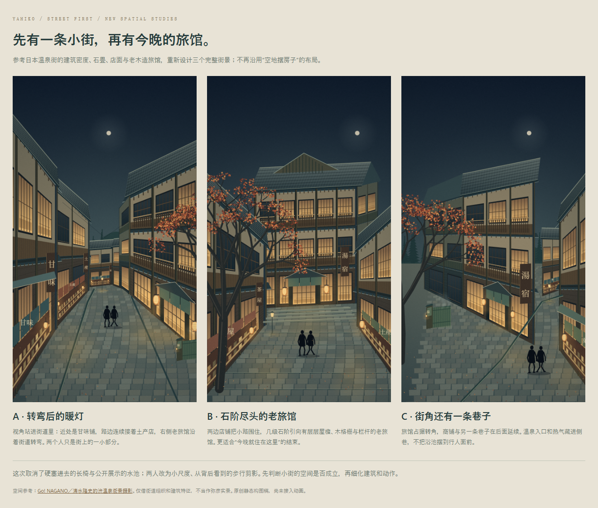

# 温泉商业小街 · 重新组织场景

用户否定了此前在空地上分别摆放旅馆、店铺、池子和人物的方式。本轮从街道与建筑的关系出发，不沿用旧布局。

- **A 转弯后的暖灯**：连续的店面与老旅馆沿小街排列，镜头站进街道里。
- **B 石阶尽头的老旅馆**：商铺围住近景小路，几级石阶通向层层木构的旅馆。
- **C 街角还有一条巷子**：旅馆占据转角，另一条巷子与商铺继续向后延伸。

长椅不再硬塞进画面，两个人缩小成一起散步的背面黑色剪影。商铺增加柜台、货品、暖帘和招牌；旅馆改为多层木构、局部灰墙、格栅窗、栏杆与层叠深檐。温泉由侧院入口、遮挡与热气交代，不朝街道展示整个浴池。

空间参考：[Go! NAGANO／清水隆史的湯田中渋温泉郷街景摄影](https://www.go-nagano.net/hot-springs-and-relaxation/id17836)。参考照片只作本地研究，未复制到此目录；场景是自由设计，不代表弥彦或「みのや」的真实外观。

打开 `index.html` 并排查看并点击放大；`render.html?scene=A`（B/C 同理）显示原尺寸单图。`street.js` 为这轮新绘制逻辑，`primitives.js` 复用基础绘图函数；`check.html` 检查三版区别、尺寸、确定性和非法编号。静态截图为 `street-A/B/C.png`。

本轮仅选空间与构图，未改原动画、字幕、音效；未制作人物动作和转场，也未做最终字幕适配。
