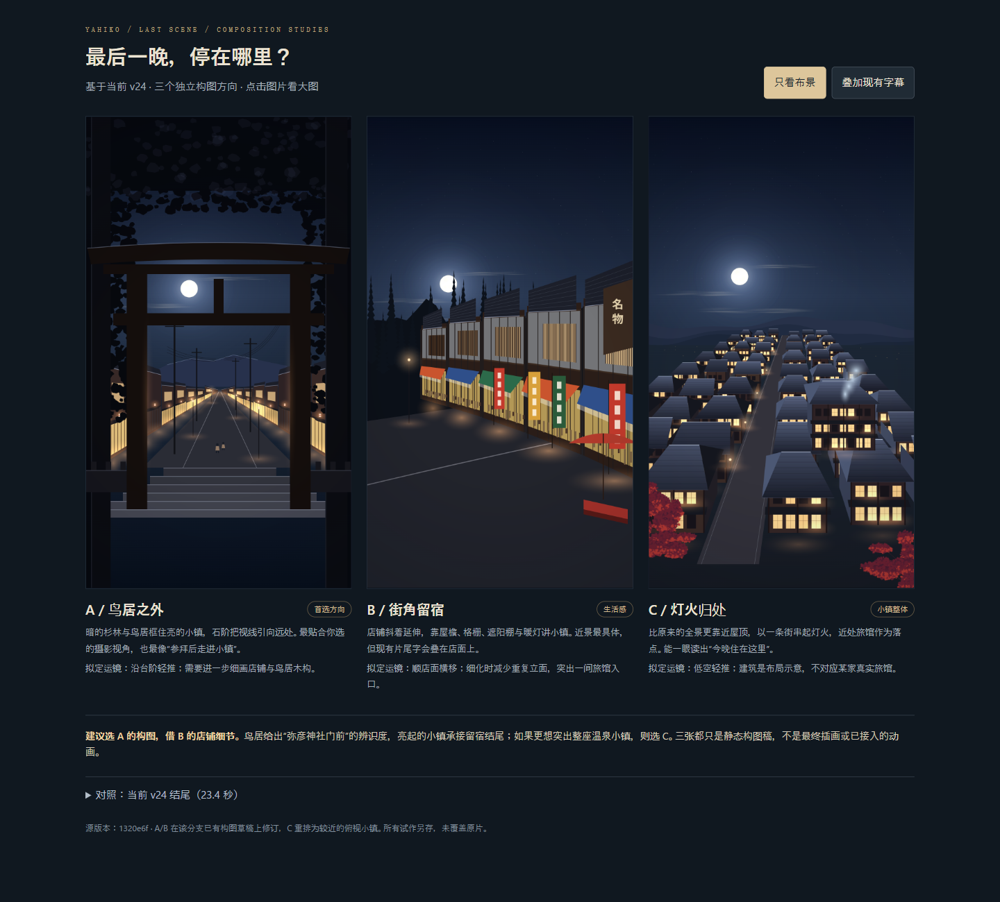

# 弥彦 v24 · 温泉小镇结尾构图试作

打开 `index.html` 并排比较三版，点击图片放大；可切换「只看布景／叠加现有字幕」，下方展开 v24 原结尾对照。图片和页面可离线查看，不需要渲染原片。

- **A 鸟居之外**：从一之鸟居内侧向门前街道看，以暗前景框出明亮小镇；建议作为主方向，后续轻推。
- **B 街角留宿**：斜向店铺街，以屋檐、格栅、遮阳棚和暖灯表现生活感；后续沿街横移。
- **C 灯火归处**：比原镜头更近的俯视构图，用开放街道和近处旅馆组织屋顶群；后续缓慢前推。

建议 A 的构图配 B 的店铺细节。三张是静态构图稿，细节和建筑比例仍待选定后完善；不是已完成的动画，不保证拟定运镜的最终效果。C 的房屋与旅馆为示意，A/B 也不是实景夜间照明的复原。

## 基线与改动边界

- 基线：`claude/adoring-darwin-982h4c`，固定提交 `1320e6f1333f4a4d1893a9d099ab4e6465d51fe2` 的 `viz/autumn/yahiko-v24.html`，原片时刻 23.4 秒。
- A/B 基于同一提交的 `stories/yahiko-town-designs/designs.js` 草稿修订：调整月亮、街道比例、亮窗、屋面纹理、立面木构等；并非声称从零创作。
- C 在 `compositions.js` 中用 v24 原有绘制函数重排更近的小镇，留出街道，突出近景旅馆。
- 现有字幕原文、字体与绘制位置不改。叠字图只做遮挡检查，不表示现有片尾每句话都应继续保留。
- 不改 v24、环境音、总时长、其他镜头或既有草稿；不合并两个分支。

## 源码复现

1. 取上述固定提交的 `viz/autumn/yahiko-v24.html`，另存 `preview.html`。
2. 在副本 `</body>` 前加入 ``。
3. 用本地 HTTP 服务打开 `preview.html?record=1&study=A`，等待 `window.STUDY_READY`；原片预计算较重，初次加载可能较久。
4. `renderStudy('A', true)` 切到叠字版，第二参数 `false` 为纯布景；方案支持 A/B/C/original。
5. 导出时设置 `document.body.classList.add('capture')`，截取 `#c` 得到 1080×1920 图片。

## 验证

`node check.cjs`：七张图片尺寸、图片链接、三版卡片与 JS 语法。

已在浏览器实际切换三版、纯布景与叠字显示，检查了截图和桌面横向溢出；另检查移动端布局。未做运镜、转场或声音验证，因为这轮是静态构图选择。
