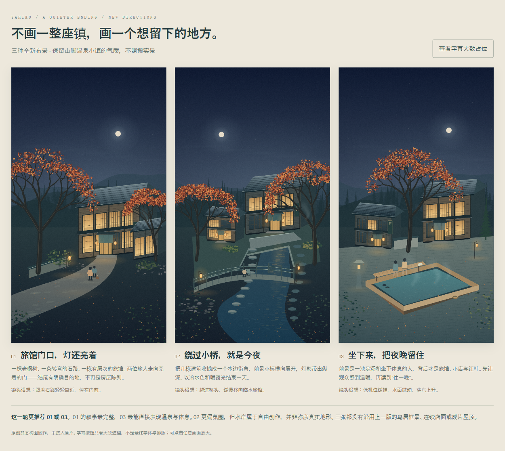

# 弥彦温泉小镇 · 重新设计

上一轮 A/B/C 已被用户否定。本轮不沿用其构图、绘图函数或房屋排列，也不按照片还原地形；只保留山脚温泉小镇、低层木造旅馆、秋夜、暖灯这些背景特征。

打开 `index.html` 比较三张；可点击放大，字幕按钮仅检查大致遮挡，不代表最终文字排版。页面没有外部依赖，可离线打开。

1. **旅馆门口，灯还亮着**：弯曲石路与老枫树引导视线，两位旅人走向一栋暖灯旅馆，强调“抵达”。
2. **绕过小桥，就是今夜**：以几栋临水建筑、小桥和倒影组成安静街角，强调“停留”；水岸为自由设计，不是弥彦真实地形。
3. **坐下来，把夜晚留住**：足汤与休息的人作为前景，旅馆和小店退到背景，强调“放松”。

更推荐 1 或 3：1 的片尾叙事清楚，3 最直接传达温泉体验。建筑不对应真实商家；不得把示意旅馆当成「みのや」的实景外观。

## 文件

- `art.js`：全新 Canvas 手工绘制，三个构图共享屋面、木构、植被、灯光等小型绘制函数；不调用旧方案的源码，无外部图片素材。
- `index.html`：三版比较、放大和字幕占位切换。
- `render.html?id=1`（或 2、3）：900×1600 的单图绘制页。
- `concept-1.png`～`concept-3.png`：各版原尺寸静态导出。
- `comparison.png`：比较页面截图。
- `check.html`：浏览器自检；检查不同构图、绘制尺寸、确定性与非法编号。

已检查三图、放大与字幕切换；页面无外部依赖。未接入 v24，未改字幕、声音或原动画，也未制作转场和运镜。当前绘画精度是构图试作，不是最终动画素材。
